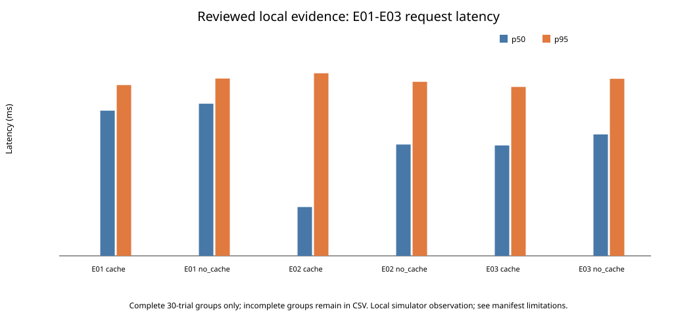

# Simulation and Security Analysis of Kerberos-Style Ticket-Based Authentication: Replay Attack Mitigation and Kerberoasting Vulnerability Assessment

> **Manuscript Status (Neutral Assembly Draft):** Assembled by Role D from A08-approved sources (`docs/report/content/lead/approval.md`) at `main` `a6a0e227ae5b1ec351c1680d4a96ce9a1b774255`. Conference template, author list/affiliations, page limit, and submission deadline remain pending human/professor input (see `docs/usage/submission-inventory.md`).

**Authors:** *[Pending — Author 1 (Lead), Author 2, Author 3, Author 4]*  
**Bibliography:** [references.bib](references.bib)

---

## Abstract

Ticket-based network authentication separates initial user verification from subsequent service access, reducing repeated exposure of long-term user secrets. However, correctness depends on strict cryptographic binding, freshness checks, and stateful replay tracking. This paper presents an educational, single-host Python/Flask simulator implementing a Kerberos-style Authentication Server (AS), Ticket-Granting Server (TGS), CLI client, and protected resource server. Using identical AES-256-GCM tickets, HMAC-SHA-256 request authenticators, and logical clock controls, we compare an intentionally incomplete no-cache control (`authenticator_no_cache`) against a persistent atomic SQLite replay store (`authenticator_cache`) that records consumed request identities and increments a protected operation counter within a single transaction. Across 30 independent trials per condition (300 requests), the no-cache control accepted 30/30 exact duplicate requests while the persistent cache accepted 0/30, with 0/90 legitimate-request rejections in both modes. Functional smoke runs (46 attempts across E01–E10) further demonstrate single-operation serialization across 2, 4, and 8 concurrent worker processes, replay rejection across ordinary process restarts and ±15-second logical clock shifts, fail-closed `503` behavior on missing or corrupt stores, and expected inclusive ±30-second skew/leeway boundaries. An optional, bounded Kerberoasting-inspired offline verification experiment (E11–E12, PBKDF2-HMAC-SHA256 with AES-256-GCM) illustrates that authenticated encryption alone does not prevent recovery of a weak password present in a 5-word list (4/5 attempts), whereas a generated random password absent from that list is not recovered within the 5-attempt budget. We present these results as an evaluated student implementation and controlled local measurement study of established defenses, without claiming a new protocol, a new Kerberos vulnerability, or Active Directory interoperability.

---

## 1. Objectives and Background

1. **Reproducible educational implementation:** Build a modular, testable local ticket-authentication lab with explicit JSON/HTTP contracts, role-separated keys, and deterministic clock injection.
2. **Controlled replay-mitigation evaluation:** Isolate the effect of persistent atomic replay tracking by holding ticket format, MAC verification, body/endpoint binding, and time validation constant between `authenticator_no_cache` and `authenticator_cache`, and testing concurrency, ordinary restart, and missing/corrupt store states.
3. **Bounded offline password-guessing demonstration:** Illustrate why password strength and key derivation remain critical even when service tickets use authenticated encryption (AES-256-GCM).

**Contribution boundary:** Replay caching, session-key-authenticated nonces, and clock-skew bounds are established mechanisms specified in RFC 4120 §3.2.3 and tested in upstream implementations such as MIT Kerberos (`t_rcfile2.c`). This project's contribution is a reproducible student implementation and systematic local evaluation of those mechanisms, not a new cryptographic protocol or a previously unknown Kerberos flaw.

**Related Work:** Needham and Schroeder (1978, 1987) introduced trusted authentication servers, session-key distribution, and nonce-based challenge/response exchanges. Bellovin and Merritt (1990; expanded Winter USENIX 1991) analyzed replay-cache implementation challenges, unauthenticated time-service risks, and offline password-guessing attacks against password-derived ciphertexts. Davis, Geer, and Ts'o (1996) further examined clock-drift handling in Kerberos. Pöhn and Hommel (2023) provide a taxonomy of identity-management attacks for background classification (without evaluating Kerberoasting mechanics). Microsoft's Kerberoasting guidance (2024) and MITRE ATT&CK T1558.003 note that AES encryption alone does not protect weak service-account passwords against offline guessing, and that TGS requests can generate observable controller telemetry (e.g., Windows Event 4769) while subsequent offline guessing generates none.

---

## 2. Threat Model and Security Design

### 2.1 Threat Model and Trust Boundaries

The simulator models a single-host local environment (`127.0.0.1`) with one synthetic client (`alice`), one combined KDC process (AS + TGS roles on port 5000), and one or more resource-server worker processes (port 5001 or distinct loopback ports for concurrency).

- **In-scope adversary capabilities:**
  - Capturing a valid `POST /access-resource` JSON request and replaying the exact bytes (or reformatted JSON) within the ticket and authenticator validity window.
  - Submitting concurrent duplicate requests to multiple resource-server workers sharing the same service key and replay store.
  - Replaying a previously consumed request after an ordinary resource-server process restart or a simulated ±15-second logical clock shift.
  - Modifying ticket ciphertexts, authenticator fields, HTTP method/path context, service audience, or request bodies, or presenting a TGT to the resource endpoint.
  - Performing offline dictionary verification against a synthetically acquired service ticket (E11–E12) without network interaction.
- **Declared simplifications and out-of-scope threats:**
  - **Trusted local host and loopback JSON:** Login credentials and session keys are delivered over local JSON without TLS, ASN.1 encoding, or Kerberos pre-authentication. A privileged local administrator who can read `data/private/` keys or substitute valid SQLite snapshots before process startup is out of scope.
  - **Logical clocks only:** Host system time and NTP are never modified; clock offsets and frozen timestamps are injected per role.
  - **Ordinary restart vs. storage/power faults:** Process termination and restart are tested; power-loss durability, disk write-cache loss, and distributed multi-host replay coordination are outside this model.

*Diagrams:* See editable Mermaid sources in [architecture.mmd](../../diagrams/architecture.mmd), [normal-authentication.mmd](../../diagrams/normal-authentication.mmd), and [replay-cache-comparison.mmd](../../diagrams/replay-cache-comparison.mmd).

### 2.2 Cryptographic and Protocol Design

1. **Key separation and password verification:** `scripts/init_demo.py` generates independent 32-byte long-term keys for the TGS (`tgs.key`) and resource service (`service.key`), plus a salted Scrypt verifier (`n=16384, r=8, p=1`, 16-byte salt) in `user.json` for `alice`.
2. **Ticket envelopes (AES-256-GCM):** Both TGTs (`kind="tgt"`, `service_id="tgs"`) and service tickets (`kind="service"`, `service_id="files"`) are serialized as canonical ASCII JSON (`canonical_bytes`) and sealed with `AESGCM` using a fresh 12-byte random nonce and domain-separated AAD (`ins-kerberos-lab:ticket:v1:<kind>`).
3. **Request authenticators (HMAC-SHA-256):** Each `POST /service-ticket` or `POST /access-resource` request includes an authenticator bound to `client_id`, `service_id`, `ticket_id`, `timestamp`, a 32-hex-character `request_nonce`, `method`, `path`, `body_sha256`, and `ticket_sha256`. The MAC is computed over explicit domain prefixes (`ins-kerberos-lab:auth:v1:tgs\0` and `ins-kerberos-lab:auth:v1:resource\0`) using the corresponding session key.
4. **Strict validation and error stability:** Parsers reject duplicate JSON keys, non-finite floats, booleans in integer fields, unknown keys, and oversized payloads (`>65,536` bytes) with `400 malformed_request`. Authentication, integrity, audience, and time-window failures return `401 invalid_authentication` without leaking internal decryption or timing diagnostics.

### 2.3 Persistent Atomic Replay Defense and Time Rules

- **Atomic SQLite transaction:** In `authenticator_cache` mode, `ReplayStore.consume_and_increment` opens a per-request SQLite connection (`DELETE` rollback journal, `synchronous=FULL`, `BEGIN IMMEDIATE`) and checks `(service_id, ticket_id, request_nonce)` uniqueness before incrementing the `counters` table in the **same transaction**. A failed counter update rolls back the nonce reservation.
- **Fail-closed storage semantics:** Missing, replaced, schema-mismatched, corrupt, or capacity-exhausted replay stores raise `ReplayStateUnavailable` (`503 replay_state_unavailable`) rather than falling back to no-cache execution.
- **Time-window boundaries (inclusive):** Default ticket lifetime is 300 seconds, with `allowed_clock_skew_seconds = 30` and `ticket_boundary_leeway_seconds = 30`. Both authenticator freshness (`|now - timestamp| <= 30`) and ticket validity (`not_before - 30 <= now <= expires_at + 30`) are inclusive. Retained replay entries are never purged by clock rollback during a run, so consumed identities remain rejected (`409 replay_detected`) if logical time moves backward.

---

## 3. Experimental Methods (B06)

### 3.1 System and Comparison Controls

Two resource-server modes are compared: `authenticator_no_cache` validates requests but omits resource-request replay tracking; `authenticator_cache` consumes the authenticated request identity and increments the SQLite-backed operation counter in one transaction. The TGS checks and its replay store are unchanged between modes. The no-cache mode is an intentionally incomplete control, not a description of standard Kerberos behavior.

### 3.2 Experimental Design and Measurements

The runner executes E01–E10 in trial-major order. Every independent trial initializes fresh private state; paired mode conditions clone equivalent initial state (mode order fixed: no-cache followed by cache). E05 starts separate resource processes on distinct loopback ports sharing one service key and SQLite store. E06 and E10 retain the store across ordinary resource-process restarts.

- **Smoke run (`a07-final-smoke-20261124`):** 1 trial across E01–E10 (`46` HTTP attempts, `0` failed).
- **Repeated run (`a07-final-perf-30-20261124`):** 30 independent trials per mode for E01–E03 (`300` HTTP attempts total, `0` failed).
- **Calculations:** Duplicate acceptance is calculated only from the second exact E02 request in each trial. Legitimate-request rejection pools E01 and E03. E04 is summarized per mutation phase (`expected=1` per trial/phase). Request latency uses `time.perf_counter_ns` around each loopback HTTP request; startup timing measures from `subprocess.Popen` return until the first healthy `/health` response. Percentiles use nearest rank (`sorted[ceil(p*n)-1]`).

---

## 4. Measured Results

### 4.1 Functional Smoke Observations (E01–E10)

The one-trial E01–E10 smoke run produced **46 attempts**, all with expected outcomes and zero failed or transport attempts:

- **E01–E03:** Normal access accepted in both modes; E02 duplicate accepted in no-cache and rejected (`409`) in cache; E03 fresh authenticators accepted in both modes.
- **E04:** Each of the four mutation phases (`mutated_ticket`, `mutated_authenticator`, `mutated_service`, `mutated_body`) had `expected=1`, `observed=1`, `missing=0` (three `401`, one `400`).
- **E05:** Defended 2-, 4-, and 8-worker concurrency conditions each returned exactly `1` successful response and `counter_max = 1`.
- **E06 & E10:** Exact replays after ordinary process restart (`E06`) and ±15-second logical-time restarts (`E10`) returned `409`.
- **E07 & E08:** Offsets −15, 0, +15 s accepted and −60, +60 s rejected (`E07`); inclusive ticket-leeway edges −30 and +330 s accepted and −31, +331 s rejected (`E08`).
- **E09:** Missing and corrupt replay stores each returned `503 replay_state_unavailable`.

### 4.2 Repeated E01–E03 Outcomes and Latency

| Measure | Cache mode | No-cache control |
| --- | ---: | ---: |
| E01 initial requests accepted | 30/30 | 30/30 |
| E02 exact duplicate requests accepted | 0/30 | 30/30 |
| E03 fresh authenticated requests accepted | 60/60 | 60/60 |
| E01+E03 legitimate requests rejected | 0/90 | 0/90 |

Request-latency and trial-median latency (ms, nearest-rank p50/p95, from `../assets/performance_summary.csv`):

| Scenario | Mode | Requests | Request p50 | Request p95 | Trial-median p50 | Trial-median p95 |
| --- | --- | ---: | ---: | ---: | ---: | ---: |
| E01 | Cache | 30 | 11.8839 | 13.9820 | 11.8839 | 13.9820 |
| E01 | No-cache | 30 | 12.4544 | 14.5174 | 12.4544 | 14.5174 |
| E02 | Cache | 60 | 3.9937 | 14.9442 | 7.8096 | 9.2784 |
| E02 | No-cache | 60 | 9.1162 | 14.2462 | 9.9586 | 11.3091 |
| E03 | Cache | 60 | 9.0404 | 13.8268 | 10.0068 | 11.0278 |
| E03 | No-cache | 60 | 9.9426 | 14.4951 | 9.9624 | 11.4938 |

*Figure:* 

### 4.3 Optional Extension: Bounded Service-Password Guessing (E11–E12, A09)

Using shared `derive_service_key` (`PBKDF2-HMAC-SHA256`, 16-byte salt, `100,000` iterations) and `seal_ticket`/`open_ticket` (`AES-256-GCM`) against `data/wordlists/demo.txt` (5 candidates, budget 5, zero network calls during verification; `../assets/extension_summary.csv`):

| Case | Password class | Attempts | Elapsed (ms) | Outcome |
| --- | --- | ---: | ---: | --- |
| E11 | `weak_in_list` | 4 / 5 | 113.9911 | `recovered` (index 4) |
| E12 | `random_absent` | 5 / 5 | 165.0101 | `not_recovered_within_list_budget` |

---

## 5. Discussion, Limitations, and Conclusions

- **Discussion:** Persistent atomic replay tracking eliminates exact-duplicate acceptance (`0/30` vs. `30/30`) across single-process, multi-worker (`2/4/8`), and restart scenarios while preserving legitimate ticket reuse (`0/90` rejections). Latency differences reflect fixed mode order, cold starts, and mixed accept/409 responses in E02 rather than a general throughput claim. E11–E12 confirm that AES-GCM authenticated encryption does not prevent offline dictionary recovery when the service key derives from a weak password.
- **Limitations:** (1) Custom single-host educational JSON/HTTP simulator, not production Kerberos/AD or Event 4769 telemetry; (2) only E01–E03 have 30 repeated trials; (3) SQLite `DELETE` journal + `synchronous=FULL` covers ordinary process restarts, not power loss, hostile rollback, or exactly-once response recovery; (4) native Windows ACL/process lifecycle checks remain unverified.
- **Conclusions and Future Work:** Combining session-key-authenticated per-request nonces with an atomic persistent replay store blocks replay attacks without hurting legitimate ticket reuse, while strong random service keys remain essential against offline guessing. Future work includes native Windows validation, a challenge-response or cache-expiry comparison, and benchmarking against a pinned MIT Kerberos (`krb5`) adapter.
